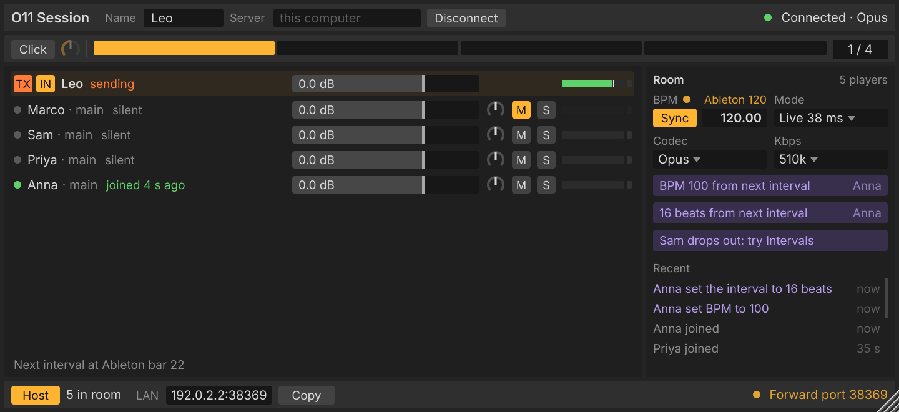

<div align="center">

# O11 Session

### Play with your band in real time, from anywhere, right inside your DAW.

[](https://github.com/LeonidStern/o11-session/actions/workflows/o11session.yml)


[**Download**](#download) · [Live mode](#live-mode) · [Intervals mode](#intervals-mode) · [Ableton Link](#auto-bpm-with-ableton-link) · [Per-player routing](#every-player-on-their-own-channel) · [Rock-solid timing](#rock-solid-timing) · [FAQ](#faq)

</div>

<p align="center"></p>

O11 Session is a plug-in that turns your DAW into a shared rehearsal room.
Put it on a track, send the room address to your bandmates, and jam over the
internet, each of you in your own studio with your own instruments, sounds
and mix.

## Why O11 Session

- 🎸 **Two ways to play, one room.** Live mode for real-time feel, Intervals
  mode for perfect timing at any distance. Switch with one click.
- 🥁 **Auto BPM.** Your DAW follows the room's tempo and bars through Ableton
  Link.
- ⏱️ **Built not to drift.** Continuous clock correction and smart stall
  recovery keep everyone locked together for the whole session.
- 🎛️ **Every player on their own channel.** Route each bandmate to a separate
  track in your DAW to mix, record and add effects.
- 🚀 **Host with one click.** The room runs inside the plug-in. No server to
  rent, nothing to configure.

## Download

| Platform | Download |
|---|---|
| **macOS, Apple silicon** (M1 and later, macOS 12+) | [O11Session-macos-arm64.dmg](https://github.com/LeonidStern/o11-session/releases/download/o11session-latest/O11Session-macos-arm64.dmg) |
| **macOS, Intel** (macOS 12+) | [O11Session-macos-x86_64.dmg](https://github.com/LeonidStern/o11-session/releases/download/o11session-latest/O11Session-macos-x86_64.dmg) |
| **Windows** (64-bit) | [O11Session-windows-x64.zip](https://github.com/LeonidStern/o11-session/releases/download/o11session-latest/O11Session-windows-x64.zip) |
| **Linux** (x86_64) | [O11Session-linux-x86_64.zip](https://github.com/LeonidStern/o11-session/releases/download/o11session-latest/O11Session-linux-x86_64.zip) |

These links always point to the newest build. Works in Ableton, Bitwig,
Reaper, Studio One, Cubase and any other VST3 host.

**Install or update from the terminal** (macOS and Linux). This puts the newest
build in `~/Library/Audio/Plug-Ins/VST3` on macOS (after checking its signature)
or in `~/.vst3` on Linux, replacing the copy that is there:

```sh
curl -fsSL https://raw.githubusercontent.com/LeonidStern/o11-session/main/plugin/install.sh | sh
```

Add `-s rc0.2` after `sh` for a release candidate instead of the newest build.

## Quick start

1. **Install.** On macOS, open the disk image, open `/Library/Audio/Plug-Ins/VST3`
   (in Finder: Go, Go to Folder), and drag O11 Session into that folder's window (it is signed and notarized by Apple). On Windows, copy
   `O11Session.vst3` into `C:\Program Files\Common Files\VST3`. On Linux, copy
   it into `~/.vst3`. On macOS and Linux, the
   [one-line terminal install](#download) does this for you and also updates later.
   Then rescan plug-ins in your DAW.
2. **Start a room.** Put O11 Session on a track and press Host. It opens the
   room on your computer, asks your router to let people in, and shows the
   address to share.
3. **Invite your band.** They paste the address into their own copy and join.
4. **Play.** Each player arrives on their own output in your DAW
   ([see routing](#every-player-on-their-own-channel)).

## Live mode

**Play together, right now.** Live mode sends your audio straight to every
other player the moment you play it. No server in the middle and no bar of
delay: you hear each other as if you were in the same room, as far as the
distance allows.

- **Direct, all to all.** Every player sends to every other player over the
  shortest path the internet has.
- **10 ms Opus frames at 128 kbps** for low delay and steady sound.
- **A self-tuning buffer.** It starts at 10 ms and steps up to 20 ms by
  itself on a connection that can't hold 10 ms. Nothing to set.
- **A room that tells you what's wrong.** If someone's connection isn't good
  enough for Live, the room names them and suggests Intervals mode. One click
  switches the whole room.

<p align="center"></p>

## Intervals mode

**Perfectly in time, at any distance.** Everyone hears everyone else a few
beats late, exactly on the beat. While you play the next phrase, the last one
arrives from the others, so the music lines up whether your band is across
town or across an ocean. Made for jams, loops, grooves and songs with a steady
pulse.

- **Pick the interval:** 2, 4, 8, 12 or 16 beats.
- **Studio sound:** Opus at up to 510 kbps, or lossless FLAC when the
  connection allows.
- **Works over any connection**, relayed through the player hosting the room.

**Seamless switching.** Every change between Live and Intervals fades over
20 ms, so it is click-free, and the room keeps its tempo and settings in both
modes.

## Auto BPM with Ableton Link

Turn on Sync and your DAW follows the room. O11 Session leads your DAW's tempo
through Ableton Link and lines up your bars with the room, so clips launch on
the room's downbeat. Change the tempo in your DAW and it becomes a vote for
the room. Works with Ableton, Bitwig and every other Link-enabled DAW; in
other DAWs the room follows your DAW's tempo and bars.

## Rock-solid timing

Playing over the internet is a fight against drift and dropouts. O11 Session
is built to win it:

- **Clock drift is corrected continuously.** Each player's audio plays a
  tiny, inaudible bit faster or slower to keep the buffer exactly where it
  belongs, so the delay never creeps up and never jumps.
- **Your bandmates' hiccups don't become yours.** When a player's computer
  misses a moment of audio, the listeners absorb the gap smoothly instead of
  falling behind for the rest of the session.
- **Catch-up done right.** After a stall, a stream catches up only by what it
  really lost, so no music is skipped that didn't need to be.
- **Lost packets are asked for again**, and anything that still doesn't
  arrive is concealed and faded out, never clicked.

## Every player on their own channel

Besides the main mix of the whole room, O11 Session has eight extra stereo
outputs, "Player 1" to "Player 8". Each player who joins gets one of their
own, so you can route every bandmate to a separate channel in your DAW:

- **Record each player on their own track**, ready to edit and mix after the
  jam.
- **Mix them like any other track:** level, pan, mute, solo, EQ, compression,
  reverb, sends.
- **Send a player anywhere:** to a headphone mix, a sidechain or an
  external output of your audio interface.

In Ableton, for example, create an audio track, set its Audio From to the
O11 Session track and pick "Player 1".

## More features

- **Room chat and votes** for tempo, interval and sound quality.
- **Built-in metronome**, saved with your project along with every setting.
- **Small and light.** One compact window and a light footprint.

## FAQ

**Do I need a server?** No. One player presses Host and the room runs inside
their plug-in.

**Live or Intervals?** Start in Live. If the room suggests Intervals, someone
is too far or on a shaky connection; switch and keep playing.

**Does it work with my DAW?** Any VST3 host on macOS, Windows or Linux.
Ableton and Bitwig also get auto BPM through Ableton Link.

## Licence

To be decided by Leonid Stern. O11 Session includes Ableton Link (GPLv2 or
later), so builds of the plug-in are GPL. It also uses JUCE (AGPLv3 or
commercial), Opus, FLAC, miniupnpc and libnatpmp.
